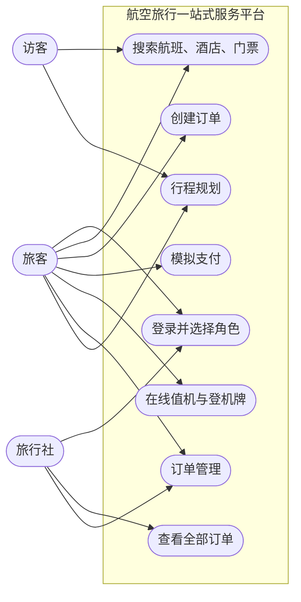
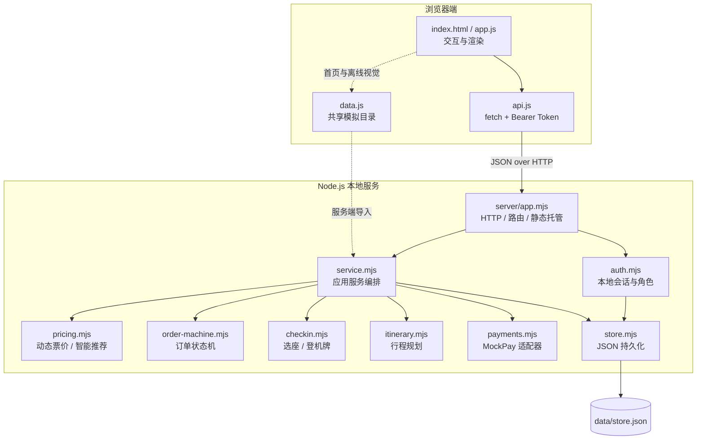
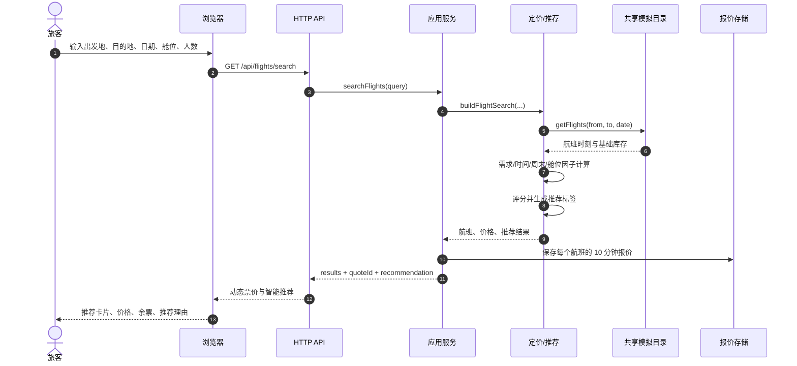
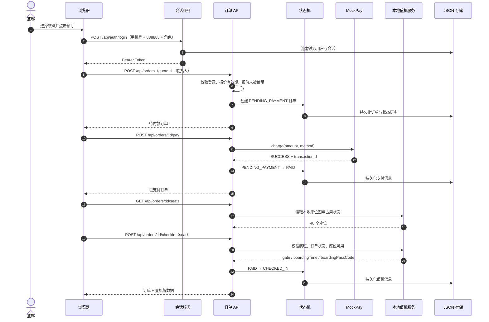
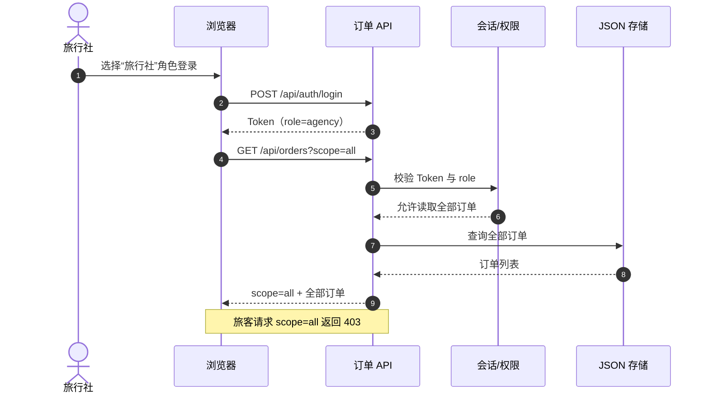
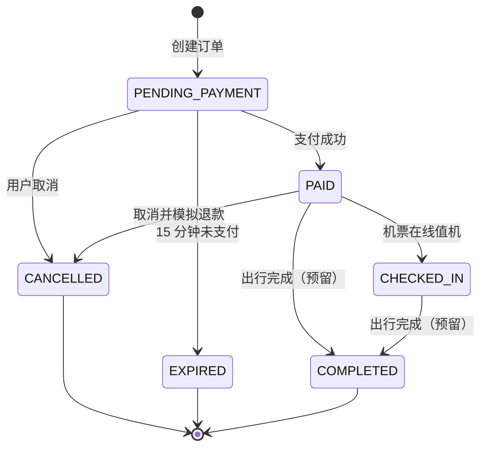

# 航空旅行一站式服务平台：分析与设计

- 文档版本：1.0
- 对应实现：`local-site/`（前端 SPA + Node 本地 API）
- 边界：本项目只使用本地模拟数据，不连接真实航信、支付、短信或身份证系统，也不会向第三方发起交易请求。

## 1. 项目定位

平台整合机票、酒店与景点门票，面向旅客和旅行社提供从搜索、动态报价、下单、模拟支付到值机/登机牌的一体化流程。核心目标是把“航班查询 → 智能推荐 → 报价 → 订单 → 支付 → 值机”这一复杂链路拆成可验证、可测试的前后端契约。

首屏以机票搜索为主入口，同时保留酒店、火车票与门票入口；酒店推荐、目的地卡片和商旅入口承担一站式平台的内容发现功能。

## 2. 角色与用例

| 角色 | 目标 | 已实现能力 |
|---|---|---|
| 访客 | 快速了解平台并搜索出行产品 | 首页、航班/酒店/门票搜索、详情、行程规划；预订时被引导登录 |
| 旅客 | 完成个人出行预订与值机 | 登录、创建订单、支付、取消、查看个人订单、在线值机与登机牌 |
| 旅行社 | 代旅客管理订单 | 以旅行社角色登录、查看全部旅客订单、查看订单详情；当前不提供企业协议价与批量出票 |
| 运营/管理员 | 商品与订单管理、风控 | 未实现，属于后续迭代 |



关键业务规则：

- 匿名用户可以搜索和查看详情，但不能创建订单。
- 订单创建后处于「待付款」；15 分钟未支付自动失效。
- 只有已支付的机票订单可以值机；酒店与门票订单在支付后等待出行。
- 只有订单所有者或旅行社角色可以读取订单；旅行社可通过 `scope=all` 查看全量订单。
- 值机前再次校验订单状态、航班日期与座位占用，避免仅依赖前端状态。

## 3. 总体架构



分层职责：

| 层 | 模块 | 职责 |
|---|---|---|
| 前端交互 | `public/app.js` | 页面状态、表单、搜索结果、订单页、值机/登机牌、降级逻辑 |
| 前端 API 客户端 | `public/api.js` | 统一请求、Token 存储、错误映射 |
| 共享目录 | `public/data.js` | 城市、酒店、航班、门票的确定性模拟库存；浏览器与 Node 服务共用 |
| HTTP 层 | `server/app.mjs` | 静态文件、路由、鉴权、JSON 解析、错误响应、安全响应头 |
| 应用层 | `server/service.mjs` | 报价存储、订单编排、权限、支付、过期处理 |
| 领域层 | `pricing.mjs` / `order-machine.mjs` / `checkin.mjs` / `itinerary.mjs` | 动态定价、状态转换、值机规则、行程生成 |
| 集成层 | `payments.mjs` | 模拟支付网关，替换点清晰 |
| 持久化 | `store.mjs` + `data/store.json` | 用户、会话、订单的本地持久化 |

设计取舍：

- **无第三方依赖**：本地演示优先保证开箱即用；HTTP 与数据持久化都使用 Node 内置能力。
- **共享目录模块**：服务端与浏览器使用同一份模拟库存，避免前端展示与后端校验出现 SKU/价格不一致。
- **服务端权威**：订单金额、报价有效性、状态转换、座位占用均在后端重新校验；前端只负责展示与发起动作。
- **报价锁定**：动态票价会随时间变化，因此搜索返回 10 分钟有效的 `quoteId`；下单只接受有效且未使用的报价。
- **单进程适用**：报价保存在内存，订单保存在 JSON 文件，适合演示与单机测试；生产应替换为数据库与分布式缓存。

## 4. 关键业务事件流

### 4.1 航班查询、动态报价与推荐



### 4.2 下单、支付、值机与登机牌



### 4.3 旅行社查看全部订单



## 5. 动态票价与智能推荐

### 5.1 动态票价模型

每次搜索按 30 分钟为一个价格桶计算，账单价格与服务端报价保持一致：

```text
price = round10(
  baseFare
  × demandFactor
  × timeFactor
  × weekendFactor
  × cabinFactor
  + taxes
)
```

| 因子 | 取值范围 / 说明 |
|---|---|
| `baseFare` | 模拟目录中的基础票价 |
| `demandFactor` | 0.90–1.35，由「航线 + 日期 + 时间桶 + 航班号」确定性哈希生成 |
| `timeFactor` | 1.00–1.30，越临近出发越高 |
| `weekendFactor` | 周五/周六/周日为 1.08，其余为 1.00 |
| `cabinFactor` | 经济舱 1.00、超级经济舱 1.35、商务舱 2.60、头等舱 3.80 |
| `taxes` | 固定模拟税费 50 元 |

每次搜索还会返回：

- `priceContext.bucket`：价格时间桶；
- `priceContext.validUntil`：当前桶结束时间；
- `pricing.reasons`：例如“临近出发价格上浮”“周末出行需求较高”；
- `seatsLeft`：动态余票提示；
- `quoteId` / `quoteExpiresAt`：锁定 10 分钟的报价。

创建订单时后端重新检查报价是否存在、未过期、未使用，并使用报价中的单价与乘客数计算总额。报价被使用后不可复用，避免同一报价重复下单。

### 5.2 智能推荐

推荐分由四个归一化指标加权：

| 指标 | 权重 | 说明 |
|---|---:|---|
| 价格 | 48% | 本次搜索中的相对价格 |
| 耗时 | 24% | 总飞行时长 |
| 出发时段 | 16% | 早班/晚高峰/红眼时段的舒适度 |
| 准点率 | 12% | 模拟准点率 |

输出字段：

- `bestId` / `bestFlightNo` / `bestPrice`：综合推荐；
- `cheapestId` / `cheapestPrice`：最低价；
- `fastestId` / `fastestDuration`：最短耗时；
- 每个航班的 `recommendation.score`、`labels`（综合推荐、最低价、最短耗时）和自然语言理由；
- 前端首屏的“智能航班推荐”卡片和每条航班的推荐理由。

## 6. 订单状态机



| 当前状态 | 允许的下一状态 | 触发操作 | 业务校验 |
|---|---|---|---|
| `PENDING_PAYMENT` | `PAID` | 支付 | 金额由服务端生成；支付锁防止并发重复支付 |
| `PENDING_PAYMENT` | `CANCELLED` | 取消 | 订单所有者或旅行社 |
| `PENDING_PAYMENT` | `EXPIRED` | 超时任务 | 创建时间超过 15 分钟 |
| `PAID` | `CHECKED_IN` | 在线值机 | 仅机票；起飞前；座位可用 |
| `PAID` | `CANCELLED` | 取消 | 生成模拟退款记录 |
| `CHECKED_IN` | `COMPLETED` | 预留 | 当前未开放 |
| `CANCELLED` / `EXPIRED` / `COMPLETED` | 无 | — | 终态，不可支付或值机 |

不变量：

- 任意时刻只能通过状态机 API 改变状态；非法转换返回 409 `INVALID_ORDER_STATE`。
- 每次状态变化写入 `history`（状态、时间、原因）。
- 已值机订单不可取消。
- 支付成功但重复支付返回 409；同一报价只能创建一个订单。

## 7. 外部模拟 API 集成方案

当前实现和真实接入的替换点：

| 外部能力 | 当前实现 | 生产接入建议 |
|---|---|---|
| 支付网关 | `server/payments.mjs` 的 `charge({orderId, amount, method})`，本地延迟后返回成功流水 | 接入持牌支付服务；增加商户签名、幂等键、异步 webhook、退款接口、超时与重试 |
| 航信/航班库存 | `public/data.js` 的确定性模拟航班目录 + `pricing.mjs` 动态价格 | 通过服务端供应商适配器访问持牌 GDS/航司 API；加入缓存、限流、舱位库存校验与报价过期处理 |
| 值机/DCS | `server/checkin.mjs` 的本地座位图、登机口与登机牌 | 调用航司 DCS/离港系统；服务端保存 PNR/票号；座位锁定时效与登机牌签名 |
| 短信/身份认证 | 固定验证码 `888888` + 本地 Bearer Token | 短信服务 + OIDC/多因素认证 + 会话轮换；禁止生产使用固定验证码 |
| 酒店/门票库存 | 共享模拟目录 | 供应商适配器、库存缓存、价格与取消政策校验 |

集成原则：

- 外部调用只发生在服务端，浏览器不直接持有供应商密钥。
- 对支付与出票操作使用幂等键和订单状态锁，避免重复扣款/重复出票。
- 外部失败与内部失败分开建模；保留供应商流水号和可观测性字段。
- 所有金额在后端重新计算并校验，不接受前端传入的“应付金额”。
- 真实接入需要供应商授权、合规评估与相应的安全审计。

## 8. API 契约

所有 API 响应为 JSON；除登录、健康检查、搜索和行程规划外，均需要 `Authorization: Bearer <token>`。

| 方法 | 路径 | 鉴权 | 说明 |
|---|---|---|---|
| GET | `/api/health` | 否 | 服务状态、功能列表与计数 |
| GET | `/api/cities` | 否 | 本地城市列表，可按 `region` 过滤 |
| POST | `/api/auth/login` | 否 | `{phone, code, role}`；演示验证码 `888888` |
| GET | `/api/auth/me` | 是 | 获取当前用户与角色 |
| POST | `/api/auth/logout` | 是 | 注销会话 |
| GET | `/api/flights/search` | 否 | `from,to,date,passengers,cabin`；可带 `airline,departWindow,maxPrice` |
| GET | `/api/hotels/search` | 否 | `city,checkin,checkout[,keyword,level]` |
| GET | `/api/attractions/search` | 否 | `city,date[,keyword]` |
| POST | `/api/itineraries` | 否 | `{city, days, preferences}` |
| POST | `/api/orders` | 是 | `type=flight` 用 `quoteId`；`hotel` 用 `hotelId/roomIndex/checkin/checkout`；`ticket` 用 `ticketId/city/date` |
| GET | `/api/orders` | 是 | 当前用户订单；旅行社可加 `?scope=all` |
| GET | `/api/orders/:id` | 是 | 订单详情（所有者或旅行社） |
| POST | `/api/orders/:id/pay` | 是 | `{method: alipay|wechat|card}` |
| POST | `/api/orders/:id/cancel` | 是 | 待付款或已支付可取消 |
| GET | `/api/orders/:id/seats` | 是 | 已支付/已值机机票订单的座位图 |
| POST | `/api/orders/:id/checkin` | 是 | `{seat}`；仅已支付机票 |
| GET | `/api/orders/:id/boarding-pass` | 是 | 已值机订单的登机牌数据 |

错误统一为：

```json
{ "error": { "code": "INVALID_ORDER_STATE", "message": "订单当前状态为「已值机」，不能取消", "details": null } }
```

常见状态码：`400` 参数错误、`401` 未登录/会话失效、`403` 角色越权、`404` 资源不存在、`409` 报价/状态/座位冲突、`413` 请求体过大、`422` 字段校验失败、`500` 内部错误。

## 9. 数据模型与持久化

- `users`：`id, phone, name, role, createdAt`
- `sessions`：`token, userId, role, createdAt, expiresAt`（7 天）
- `orders`：`id, userId, type, status, statusLabel, title, dateLabel, guestLabel, total, contact, items, details, payment, checkin, history, createdAt, updatedAt`
- `quotes`：仅内存保存，`id, flight, unitPrice, passengers, expiresAt, usedAt`，10 分钟 TTL

持久化策略：

- `data/store.json` 保存用户、会话与订单；写入使用临时文件 + 原子重命名，避免部分写入。
- 测试使用临时目录，不污染演示数据。
- 报价只存在内存中，服务重启后旧报价失效；这符合“报价短时锁定”的业务语义。
- 单进程场景下 Node 事件循环与串行写入保证一致性；生产应使用数据库事务/行锁。

## 10. 安全、隐私与可靠性

已实现的基础措施：

- 订单读取与操作进行所有者/旅行社权限校验；
- 金额由后端计算，前端不传总额；
- 值机座位可用性由后端校验；
- 请求体大小限制 1 MB；
- 静态文件路径防目录穿越；
- 响应头 `X-Content-Type-Options: nosniff` 与 `Referrer-Policy: no-referrer`；
- 支付使用状态锁防止并发重复支付；
- 报价一次性使用，订单状态机拒绝非法转换；
- 演示验证码不记录真实凭据，服务端不接收支付密码。

生产化缺口：真实认证、HTTPS、CSRF/速率限制、密钥托管、审计日志、真实支付回调验签、数据库与备份、合规与隐私评估、依赖与供应链安全。

## 11. 测试与证据

- 自动化测试：`npm test`。覆盖动态定价、推荐排序、日期/舱位校验、状态机、座位冲突、值机时间、行程规划、完整 HTTP 生命周期、取消/过期、角色权限与搜索性能。
- 浏览器验证：使用 REA 对本地服务执行云端无头 Chromium 场景，覆盖首页、航班搜索、登录补全、下单、支付、值机、登机牌、订单页、酒店、门票与行程规划；均无页面错误。
- 详细结果见 [test-report.md](test-report.md) 与 [evidence.md](evidence.md)。

## 12. 后续迭代

1. 接入数据库（订单事务、旅客/乘机人表、PNR 与票号）。
2. 增加管理端：航班/酒店库存、价格规则、订单调度与退款审核。
3. 增加旅行社批量下单、企业协议价和发票信息。
4. 引入真实地图与机队/机场数据，完善出发时段与行李规则。
5. 增加无障碍审计、移动端视觉回归、端到端跨浏览器测试。
